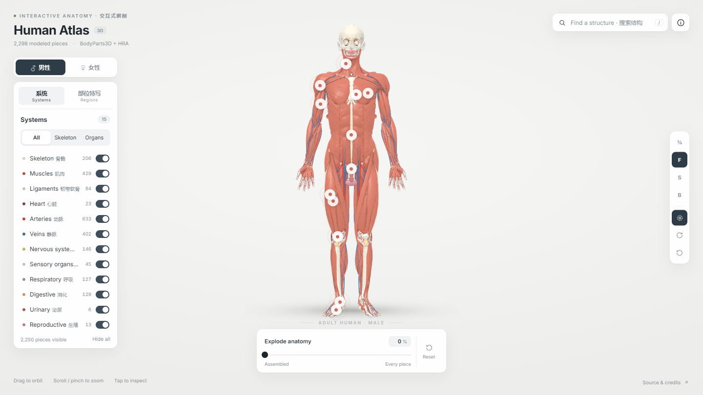
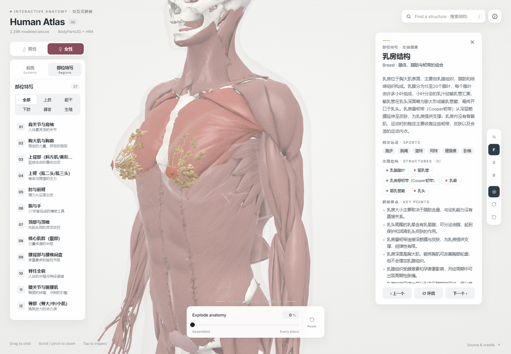
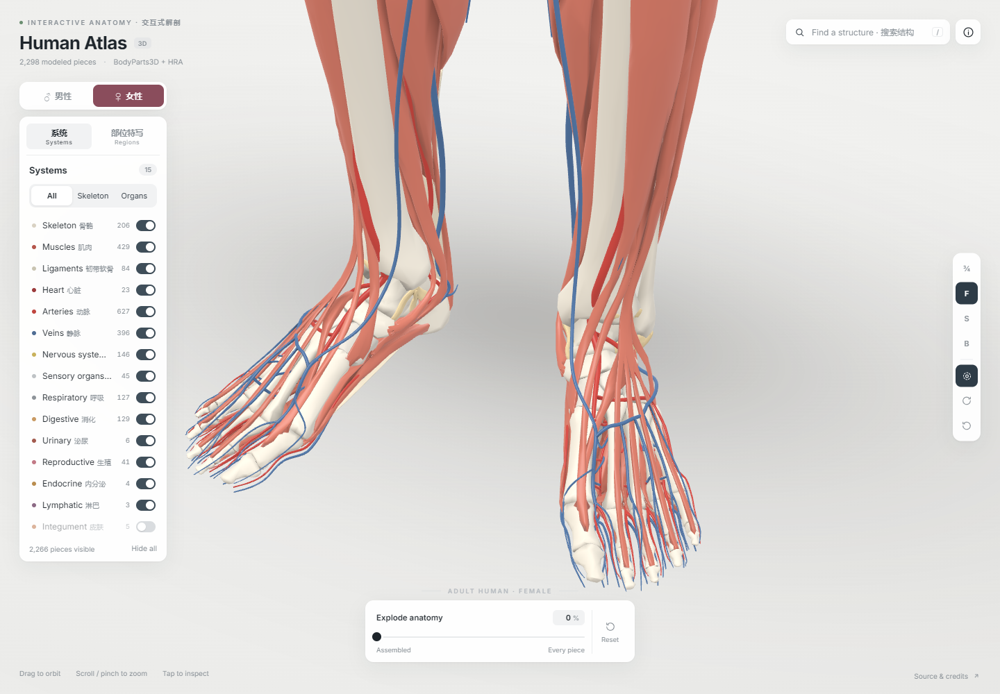

<div align="center">


# Human Atlas 3D

**从完整人体到一根肌腱，在浏览器中探索解剖结构。**

交互式人体解剖图谱 · 男 / 女模型 · 运动解剖部位特写 · 中英双语搜索

[](https://github.com/wangzh12023/human-atlas-3d/actions/workflows/ci.yml)
[](LICENSE)
[](public/ATTRIBUTION.md)
[](https://threejs.org/)
[](https://vite.dev/)
[](https://github.com/wangzh12023/human-atlas-3d/stargazers)

[快速开始](#-快速开始) · [功能](#-可以探索什么) · [操作指南](#-操作指南) · [数据与许可](#-数据来源与许可) · [参与贡献](CONTRIBUTING.md)

**简体中文** | [English](README.en.md)



<sub>真实页面截图 · 2,298 个独立结构 · 15 个系统图层 · 28 个部位特写</sub>

</div>

## ✨ 可以探索什么

Human Atlas 3D 是一个无需后端的三维解剖学习项目。旋转人体、切换图层、点击结构，再进入关节或肌群特写，把名称、空间关系和运动相关知识联系起来。模型与学习内容随仓库提供，无需 API key 或额外下载模型即可运行。

| | 功能 | 体验 |
| :--: | :-- | :-- |
| 🧍 | **男 / 女双模型** | 平滑切换模型，自动显示对应的生殖结构；共用基础体格，保持切换前后的空间参照。 |
| 🦴 | **15 个系统图层** | 骨骼、肌肉、韧带、血管、神经与器官独立开关；提供全解剖、骨骼、器官预设。 |
| 🎯 | **28 个部位特写** | 肩袖、膝、踝、足弓、核心、心肺、大脑及生殖系统等，配合自动取景与结构高亮。 |
| 🔎 | **中英双语搜索** | 输入「跟腱」「ACL」「gluteus」等关键词，定位结构或部位；名称中英对照，学习说明以中文为主。 |
| 🧩 | **两阶段分解** | 拖动 Explode 滑块，从完整人体展开为系统，再将各个结构排列成可浏览的清单。 |
| 🖱️ | **逐结构交互** | 悬停辨认、点击查看、双击聚焦、单独观察，并通过相机环绕查看空间关系。 |

### 🔬 从全身到局部

<table>
  <tr>
    <td width="50%"></td>
    <td width="50%"></td>
  </tr>
  <tr>
    <td align="center"><b>结构特写</b><br />透明外层、内部组织与中文学习卡片</td>
    <td align="center"><b>精细观察</b><br />足趾、肌腱与关节的逐结构查看</td>
  </tr>
</table>

## 🚀 快速开始

需要 **Node.js 22.12+**、npm，以及支持 **WebGL 2** 的现代浏览器。

```bash
git clone https://github.com/wangzh12023/human-atlas-3d.git
cd human-atlas-3d
npm ci
npm run dev
```

打开 **http://127.0.0.1:5178/**。首次加载会读取随仓库提供的模型数据，压缩模型文件合计约 **15.3 MiB**。

Windows 用户也可以双击 [`启动.bat`](启动.bat)，安装依赖、构建并启动生产预览。

### 📦 构建与部署

```bash
npm run check:assets
npm run build
npm run preview
```

生产预览地址为 **http://127.0.0.1:5179/**。构建产物位于 `dist/`，可部署到 GitHub Pages、Vercel、Netlify、Nginx 等静态托管服务。项目使用相对资源路径，支持部署到仓库子路径；托管配置与验证方法见 [部署指南](docs/DEPLOYMENT.md)。

请通过 HTTP 服务访问页面；直接双击 `dist/index.html` 无法正常加载模型。

## 🕹️ 操作指南

| 操作 | 鼠标 / 触控 | 快捷键 |
| :-- | :-- | :-- |
| 旋转 | 左键拖动 | — |
| 缩放 | 滚轮 / 双指缩放 | — |
| 平移 | 右键拖动 / Shift + 拖动 | — |
| 查看结构 | 点击；双击聚焦 | `Esc` 返回 |
| 搜索 | 右上角搜索框 | `/` |
| 男 / 女切换 | 左上角开关 | `M` |
| 正面 / 侧面 / 背面 | 右侧视角工具栏 | `F` / `S` / `B` |
| 重置视角 | 右侧重置按钮 | `R` |
| 上一 / 下一部位 | 特写卡片底部按钮 | `←` / `→` |

**一个探索示例：** 搜索「跟腱」→ 打开部位特写 → 点击结构标签 → 开启环绕 → 调整系统图层观察它与骨骼、肌肉的关系。

## 🛠️ 技术与结构

<p>
  
  
  
  
</p>

运行端采用原生 JavaScript、Three.js 与自定义 GLSL。模型按系统分块，通过 meshoptimizer 压缩；男女顶点位置、法线和环境遮蔽预先编码，结构状态通过 GPU 数据纹理管理。Python 管线负责原始模型处理、配准、示意结构生成和导出。

```text
human-atlas-3d/
├── src/
│   ├── engine/           # 模型加载、GLSL、相机与 GPU 拾取
│   ├── content/          # 结构说明与部位学习内容
│   ├── ui.js             # 系统图层、搜索与检查器
│   └── regions-ui.js     # 部位特写与取景
├── public/
│   ├── data/             # 已编码模型与结构清单，可直接运行
│   └── ATTRIBUTION.md    # 随部署产物保留的数据署名
├── pipeline/             # 可选 Python / Node 模型生成管线
├── tools/                # 资产检查、浏览器截图与几何校验
└── docs/                 # 部署、模型管线和页面截图
```

日常开发只需 Node.js。仅在**重新生成模型**时，才需要额外的原始数据和 Python 依赖，见 [模型管线指南](docs/PIPELINE.md)。

## 📚 数据来源与许可

| 内容 | 来源 | 许可 |
| :-- | :-- | :-- |
| 应用代码、模型处理脚本与项目学习文字 | 本项目 | [MIT](LICENSE) |
| 基础解剖模型及其改编数据 | [BodyParts3D / DBCLS](https://dbarchive.biosciencedbc.jp/en/bodyparts3d/) | [CC BY 4.0](https://dbarchive.biosciencedbc.jp/en/bodyparts3d/lic.html) |
| 女性参考器官及形态配准参考 | [Human Reference Atlas / HuBMAP](https://humanatlas.io/3d-reference-library) | [CC BY 4.0](https://humanatlas.io/3d-reference-library) |
| 编码后的混合解剖资产与包含这些模型的截图 | 改编自以上数据，并含本项目示意结构 | [CC BY 4.0](public/data/LICENSE) |
| Inter 字体 | Inter / Google Fonts，经 Fontsource 分发 | SIL Open Font License 1.1 |

**代码许可与模型数据许可分开适用。** 数据来源、署名、版本链接和改编说明见 [`public/ATTRIBUTION.md`](public/ATTRIBUTION.md)。该文件会随构建产物一起发布，请在再分发模型、截图或部署网站时保留对应署名。

女性展示模型与男性共用基础体格，仅在乳房局部和性别特有结构上保留差异。部分韧带、肌肉、乳房外形及生殖结构为示意性重建，界面会标注 `Schematic model`；它们不等同于未经修改的参考个体数据。

> 本项目面向解剖学习、科普和可视化探索，不用于诊断、治疗或临床决策。运动相关文字是一般学习内容。

## 🤝 参与贡献

欢迎改进交互、性能、可访问性、翻译和解剖学习内容。开始前请阅读 [贡献指南](CONTRIBUTING.md)。

- 🐛 [报告问题](https://github.com/wangzh12023/human-atlas-3d/issues/new?template=bug_report.yml)：附上浏览器、操作步骤与相关结构名称。
- 💡 [提出建议](https://github.com/wangzh12023/human-atlas-3d/issues/new?template=feature_request.yml)：说明希望改进的学习或浏览场景。
- 📖 解剖或运动知识修订：请提供可核查的来源，区分参考解剖与示意模型。
- 🔧 提交 PR：说明变更行为，并运行 `npm run check:assets` 与 `npm run build`。

## 🙏 致谢

感谢 **DBCLS / BodyParts3D**、**Human Reference Atlas / HuBMAP**、**NIH / National Library of Medicine Visible Human Project** 及原始模型作者的开放数据工作；感谢 **Three.js**、**meshoptimizer**、**Vite**、**Fontsource / Inter** 提供的开源工具。

<div align="center">

如果这个项目对你的学习或开发有帮助，欢迎点亮 ⭐，也欢迎提交反馈和改进。

</div>
